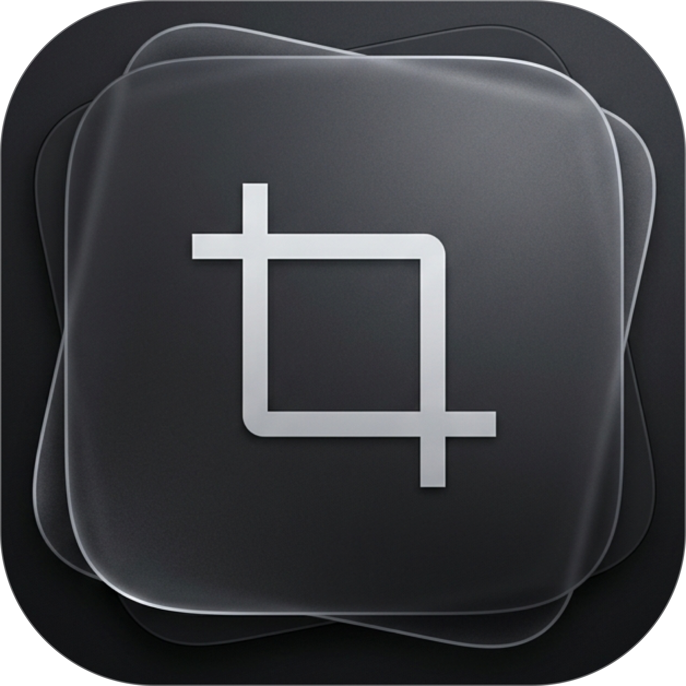
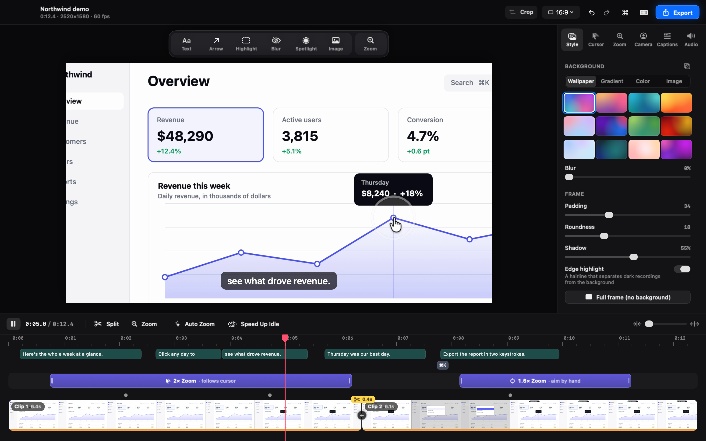
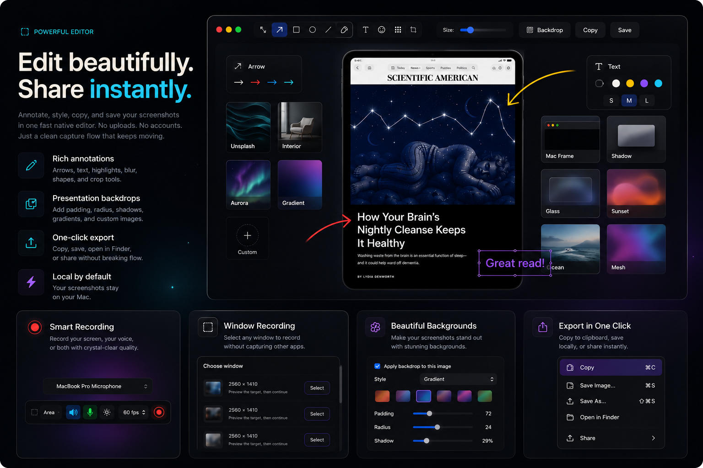
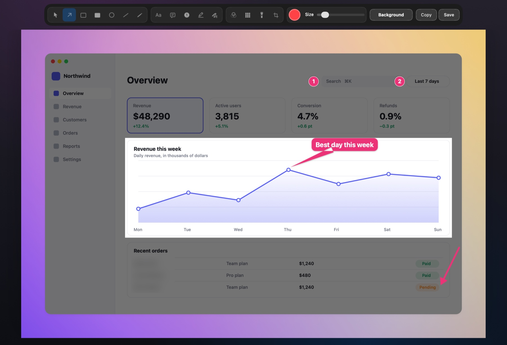
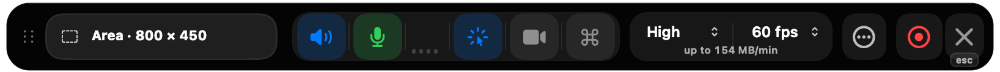

<div align="center">



# Shotnix

**スクリーンショット、画面録画、動画エディタをひとつにしたMacアプリ。**<br/>
無料のオープンソース。約11 MBのネイティブアプリで、撮ったものがMacの外に出ることはありません。

[](https://github.com/OMARVII/Shotnix/releases/latest)
[](https://github.com/OMARVII/Shotnix/stargazers)
[](#インストール)
[](LICENSE)

[Webサイト](https://shotnix.com/ja) · [ダウンロード](https://github.com/OMARVII/Shotnix/releases/latest) · [変更履歴（英語）](CHANGELOG.md) · [ロードマップ（英語）](ROADMAP.md)

[English](README.md) · [Deutsch](README.de.md) · [Français](README.fr.md) · [简体中文](README.zh-CN.md) · [Русский](README.ru.md) · [Українська](README.uk.md) · **日本語**

<a href="https://shotnix.com/media/shotnix-editor-playback.mp4"></a>

<sub>Shotnixの動画エディタで再生しているデモ。ごく普通の画面録画1本から作ったもので、クリックに合わせたズーム、なめらかなポインタ、ナレーションから作った字幕、画面上のショートカット表示が入っています。</sub>

<a href="https://shotnix.com/media/shotnix-editor-playback.mp4"><b>▶ デモを見る（Retina、60fps）</b></a><br/>
<sub>Shotnixは最大4K・60fpsで書き出せます。</sub>

</div>



## Shotnixを選ぶ理由

<table>
<tr>
<td width="50%"><b>これひとつで全部</b><br/>スクリーンショット、テキスト認識、画面への固定、履歴、画面録画、そして本格的な動画エディタ。</td>
<td width="50%"><b>ネイティブで軽量</b><br/>macOS向けにSwiftで書かれています。ダウンロードは小さく、すぐに起動して、作業の邪魔をしません。</td>
</tr>
<tr>
<td width="50%"><b>プライバシー重視の設計</b><br/>アカウントもクラウドも、分析データの収集もありません。字幕とテキスト認識はMac上で動きます。</td>
<td width="50%"><b>本当に無料</b><br/>MITライセンス。透かしもサブスクリプションもありません。署名・公証済みで、自動でアップデートされます。</td>
</tr>
</table>

## スクリーンショット



- **何でも撮れる**：範囲、ウインドウ、画面全体、すべてのディスプレイを一度に。長いページはスクロールしながら撮って、1枚の画像につなげます。
- **範囲をぴったりに**：マウスボタンを離すときに⇧を押したままにすると、撮る前に選択範囲を微調整できます。
- **注釈**：矢印、図形、テキスト、吹き出し、番号付きステップ、スポットライト、蛍光ペン、そして必ず全体を覆うぼかしとモザイク。
- **その先も**：どんなものからでもテキストをコピーでき（表やリンクも）、スクリーンショットを画面に固定し、中の文字からどのスクリーンショットでも探し出せます。

## 画面録画と動画編集

- **録画**：範囲、ウインドウ、ディスプレイを60fpsで、声、Macの音、カメラと一緒に録画します。一時停止も再開もでき、クラッシュしても録画は失われません。
- **開いた時点で編集済み**：クリックに合わせたズーム、なめらかに描き直した本物のmacOSポインタ、保存しておいたスタイル。
- **仕上げもMacで**：ナレーションから作る字幕とテキストでの編集（macOS 15以降は翻訳も）、声に合わせて音量が下がる音楽、タイトルカード、トランジション、ロゴ。
- **書き出し**：最大4K・60fpsのMP4またはGIFをバックグラウンドで書き出します。クリップボードに直接書き出すこともできます。



<details>
<summary><b>すべての機能</b></summary>

**取り込み**

- **範囲**：ドラッグして好きな範囲を選択
- **ウインドウ**：クリックしたウインドウだけを取り込みます。ドロップシャドウと透明な余白も付けられます
- **画面全体**：画面全体をすぐに取り込みます
- **すべてのディスプレイ**：接続しているすべてのディスプレイを一度に、1台につき1枚の画像で取り込みます
- **前回の範囲**：最後に選んだ範囲を、ショートカットひとつでもう一度取り込みます
- **調整できる選択範囲**：マウスボタンを離すときにShiftキーを押したままにすると（“設定”でデフォルトにすることもできます）、マウスや矢印キーで端を微調整してから、Returnキーで確定できます
- **スクロール**：長いページをスクロールすると、Shotnixが縦長の1枚の画像につなぎ合わせます。Escキーを押すか、もう一度ショートカットを押すと終了します
- **タイマー**：撮る前に3/5/10秒のカウントダウン（途中でキャンセル可能）
- **画面録画**：範囲、ウインドウ、ディスプレイを60fpsでMP4に録画し、システムオーディオ、マイクの音声、カメラも一緒に収められます。一時停止と再開、録画の破棄、3/5/10秒のカウントダウン後の開始ができます。ウインドウの録画はウインドウの動きを追い、そのメニューやシートも映ります。録画はクラッシュしても失われず、次回の起動時に復元されます。途中で切れたマイクは音声をずらさずに置き換わり、5K以上のディスプレイはHEVCで録画します。`Ctrl + Cmd + Esc`でどこからでも停止できます
- **動画エディタ**：どんな録画も洗練されたデモに仕上げます。ポインタを追うズーム、なめらかに描き直した本物のmacOSポインタ、背景、注釈（テキスト、矢印、ハイライト、ぼかし、スポットライト）、独立したレイヤーとしてのカメラ（レイアウト付き）、4種類のスタイルの字幕とMac上で行うテキストでの編集（macOS 15以降はオンデバイス翻訳も）、声に合わせて音量が下がるBGM、ロゴや画像のオーバーレイ、オープニングとエンディングのカード、トランジション、複数の録画をまとめたひとつの動画、聞きやすくした音声、縦型動画、切り取り、そしてバックグラウンドで進むMP4やGIFへの書き出し
- **OCR**：画面のどこからでもテキストを取り出し、段組みや表も読む順番どおりに保ちます。結果に含まれるリンクはクリックでき、認識する言語も選べます
- **QRコード・バーコードの読み取り**：画面で選んだ範囲から、QR、Code 128、EAN、UPC、Aztec、Data Matrix、PDF417などを読み取ります

**注釈と編集**

- 矢印、長方形（角は直角か丸）、楕円、線、フリーハンド
- テキストと吹き出し：10〜96ptの好きなサイズ、太字か標準、複数行に対応。どんな背景でも目立つアウトラインも付けられます。ダブルクリックで再編集できます
- 内容を目立たせる蛍光ペンと、フリーハンドの蛍光ペン
- 大事なところ以外を暗くするスポットライト
- 強さを調整できるぼかしとモザイク。どのディスプレイでも、枠全体を必ず覆います
- 手順ガイド向けの番号付きマーカー
- スクリーンショットをきれいに書き出すためのプレゼンテーション用背景（画像のプリセットや自分の画像も使えます）
- あとから取り消したり変更したりできる切り取り。注釈もそのまま編集できます
- エディタがどのディスプレイにあっても、取り込んだときの解像度のまま保存します。保存していない編集があるときは、閉じる前や終了する前に確認します

**作業の流れを止めない**

- 取り込むたびにクイックアクセスを表示。ポインタを重ねるとコントロール（“コピー”、“保存”、“編集”、“画面に固定”、“閉じる”）が現れます
- クイックアクセスから、Finder、Slack、ほかのアプリへ直接ドラッグ＆ドロップ
- トラックパッドのスワイプでクイックアクセスを閉じる
- コピーしたことを知らせるバッジ：閉じる前に目で確認できます
- クイックアクセスのキーボードショートカット：`Cmd+C`でコピー、`Cmd+S`で保存、`Cmd+E`で編集、`Esc`で閉じる
- クイックアクセスの右クリックメニュー
- 心地よい操作感のためのスプリングアニメーションとマイクロインタラクション
- スクリーンショットをデスクトップの上に浮かべて固定（ドラッグとサイズ変更が可能）
- グリッドで一覧できるスクリーンショットの履歴：スクリーンショット内の文字で検索（そのまま入力を始めるだけ）、取り込みの種類で絞り込み、キーボードで選択、ファイルとしてドラッグして取り出し、⌘Zで削除を取り消し
- 履歴はデフォルトでずっと保存されますが、直近7日、30日、90日だけ（または直近100件、500件、1,000件だけ）残すこともできます。使っている容量を表示し、いつでもクリーンアップできます
- 注釈エディタでの編集は履歴に表示され、元のスクリーンショットもその隣に残ります
- どこからでも使えるグローバルショートカット

**カスタマイズ**

- タブで分かれた設定ウインドウ（“一般”、“ショートカット”、“スクリーンショット”、“収録”、“情報”）
- カスタマイズできるグローバルショートカットと、ワンクリックでのデフォルトへのリセット
- 公式ビルドでは、Sparkleによるアプリ内のアップデート確認
- PNGまたはJPEGで書き出し、JPEGの画質はスライダで調整（システムが対応しているMacではWebPも）
- 自動保存先の選択。同じ1秒の間に撮ったスクリーンショットは、それぞれ番号付きの別ファイルになります
- 取り込み後の自動アクション（自動コピー、自動保存。新しくインストールした場合は、Macと同じようにすべてのスクリーンショットをファイルとして保存します）
- クイックアクセスの表示位置（左か右）と表示時間を設定可能
- 取り込み時の効果音（オン/オフを切り替え可能）
- 取り込み中にデスクトップアイコンを隠す（Finderを再起動せずに）
- ログイン時に起動
- “情報”タブにある“新機能”の変更履歴

</details>

## 言語

Shotnixは、メニューバーから動画エディタまで、**English、Deutsch、Français、简体中文、Русский、Українська、日本語**に対応しています。Macの言語に従い、ほかの言語を使いたいときはShotnixの“設定”＞“一般”＞“言語”で選べます。翻訳ファイルは[`Localization/`](Localization/)にあり、ネイティブスピーカーからの修正を歓迎しています。

## インストール

### ダウンロード（おすすめ）

1. 最新の`.dmg`を[**shotnix.com**](https://shotnix.com/ja)または[**Releases**](https://github.com/OMARVII/Shotnix/releases/latest)からダウンロードします
2. DMGを開いて、**Shotnix**を“アプリケーション”フォルダにドラッグします
3. 確認のメッセージが表示されたら、**画面収録**を許可します

### ソースからビルド

```bash
git clone https://github.com/OMARVII/Shotnix.git
cd Shotnix
bash build-app.sh
```

リリースビルドをコンパイルしてアプリバンドルを組み立て、バイナリにローカルで署名し、`Shotnix.app`を`/Applications`にコピーします。

**必要な環境**：macOS 13以降、Swift 5.9以降

## ショートカット

| ショートカット | 操作 |
|---|---|
| `Cmd + Shift + 4` | 範囲を取り込む |
| `Cmd + Shift + 5` | ウインドウを取り込む |
| `Cmd + Shift + 3` / `Cmd + Shift + 6` | 画面全体を取り込む |
| `Cmd + Shift + 7` | 前回の範囲を取り込む |

“スクロールして取り込む”、“テキストを取り込む（OCR）”、“すべてのディスプレイを取り込む”、“タイマーで取り込む”と録画の各操作には、デフォルトではショートカットがありません。ほかのアプリが使うキーをShotnixが横取りしないためです（`Cmd + Shift + S`はほとんどのアプリで“別名で保存”です）。どれも“設定”＞“ショートカット”で割り当てられます。0.24より前からインストールしている場合は、それまでの`Cmd + Shift + S`と`Cmd + Shift + O`のショートカットがそのまま残ります。

**クイックアクセスで：**

| ショートカット | 操作 |
|---|---|
| `Cmd + C` | スクリーンショットをクリップボードにコピー |
| `Cmd + S` | ファイルに保存 |
| `Cmd + E` | 注釈エディタで開く |
| `Esc` | クイックアクセスを閉じる |

**録画中：**

| ショートカット | 操作 |
|---|---|
| `Ctrl + Cmd + Esc` | 録画を停止（どのアプリからでも） |
| `Esc` | Shotnixが最前面にあるときに録画を停止 |

## プライバシー

Shotnixにはアカウントも、分析データの収集も、クラウドもありません。すべてがMac上で行われます。Shotnixが次のものを使う前に、macOSが確認を求めます：

- **画面収録とシステムオーディオ録音**：スクリーンショットの撮影と録画に使います（macOS 14以前の名前は“画面収録”）。
- **マイク**と**カメラ**：録画でオンにしたときだけ使います。
- **音声認識**：このMac上で字幕を作るために使います。
- **アクセシビリティ**（オプション）：押したキーボードショートカットを録画に表示するために使います。

アプリがインターネットに接続するのは、アップデートを確認するときだけです。

## アーキテクチャ

ShotnixはSwift Package Managerのプロジェクトで、`.xcodeproj`もストーリーボードもありません。実行ファイルは、テストできる`ShotnixCore`ライブラリを包む小さなラッパーです。

```
Sources/
├── Shotnix/       実行ファイルのエントリポイント
└── ShotnixCore/
    ├── App/           アプリのライフサイクル、メニューバー、環境設定
    ├── Capture/       スクリーンショットのエンジン（ScreenCaptureKit＋CGWindowのフォールバック）
    ├── Annotation/    15種類のツールと取り消し/やり直しを備えたエディタ
    ├── History/       永続的な履歴（~Library/Application Support/）
    ├── Hotkeys/       カスタマイズできるグローバルショートカット
    ├── OCR/           Visionフレームワークによるテキスト認識
    ├── Overlay/       クイックアクセスのサムネール、固定したウインドウ、トースト
    ├── Video/         動画エディタ：タイムライン、ズーム、ポインタ、カメラ、字幕、サウンド、書き出し
    └── Utilities/     画像の書き出し、アクセス許可、デスクトップアイコンの切り替え
Localization/          String Catalog、翻訳、用語集（scripts/localize.py）
```

## 依存関係

| パッケージ | 用途 |
|---|---|
| [KeyboardShortcuts](https://github.com/sindresorhus/KeyboardShortcuts) | カスタマイズできるグローバルキーボードショートカット |
| [Sparkle](https://sparkle-project.org/) | 署名済みリリースのアプリ内アップデート確認 |

依存関係は、今も意図して最小限にとどめています。

## ロードマップ

- [x] 複数ディスプレイでの取り込みの修正
- [x] 初回起動時のオンボーディング
- [x] WebPでの書き出し
- [x] 取り込み後の自動アクション
- [x] クイックアクセスのデザイン刷新（ポインタを重ねると現れるコントロール、スプリングアニメーション、スワイプで閉じる）
- [x] すっきりした注釈ツールバー（状況に応じたボタン、中央に置いたキャンバス、ダークなエディタ背景）
- [x] 番号付きステップの注釈ツール
- [x] 新しいブランディング（アプリアイコン、メニューバーアイコン、ようこそ画面）
- [x] 設定画面と取り込みエンジンの刷新
- [x] キビキビしたクイックアクセスのアニメーション＋触覚フィードバック＋ピクセル単位で正確なボタン
- [x] ネイティブなmacOS API（古いシェルの`Process()`呼び出しを置き換え）
- [x] カスタマイズできるショートカット
- [x] シャドウと余白付きのウインドウ取り込み
- [x] 遅延・タイマー取り込み（3秒、5秒、10秒）
- [x] 自動アップデートの仕組み
- [x] 開発者署名＋公証のワークフロー
- [x] 取り込み後のサムネールの重ね表示
- [x] 動画エディタ：ズーム、なめらかなポインタ、背景、カメラ、字幕、テキストでの編集、MP4/GIFへの書き出し
- [x] 調整できる選択範囲、本格的なスクロール取り込みのつなぎ合わせ、レイアウトを理解するOCR
- [x] 新しい注釈ツール：スポットライト、吹き出し、フリーハンドの蛍光ペン、角丸の長方形
- [x] 履歴の保存期間、クリーンアップ、種類での絞り込み
- [x] 一時停止・再開、破棄、クラッシュに強い録画
- [x] 動画エディタ：音楽、画像のオーバーレイ、タイトルカード、トランジション、複数の録画を使うプロジェクト、字幕のスタイルと翻訳
- [x] ローカリゼーション：ドイツ語、フランス語、簡体字中国語、ロシア語、ウクライナ語、日本語

## コントリビュート

コントリビュートを歓迎します。変えたい内容があれば、まずIssueを立てて相談してください。翻訳の修正は特に歓迎です。[`Localization/GLOSSARY.md`](Localization/GLOSSARY.md)をご覧ください。

Shotnixで時間を節約できたら、GitHubで⭐を付けてもらえると、ほかの人にも見つけてもらいやすくなります。

## ライセンス

[MIT](LICENSE)。サードパーティ素材の出所は[THIRD_PARTY_NOTICES.md](THIRD_PARTY_NOTICES.md)に記載しています。
